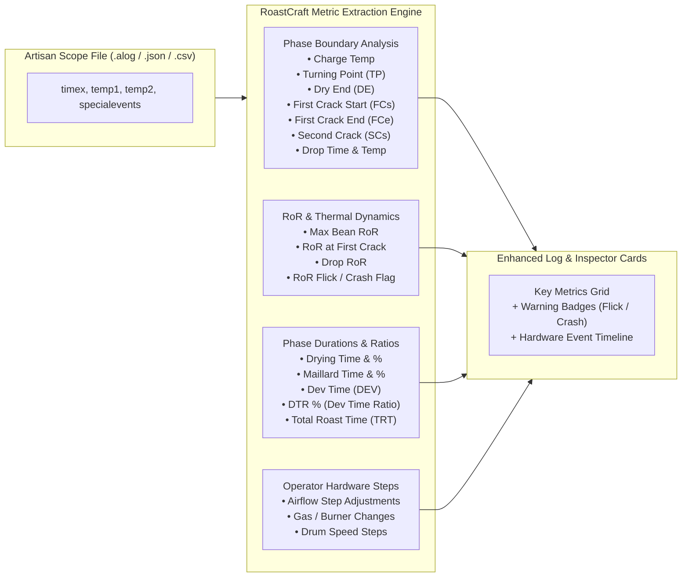

# RoastCraft: Future Improvements & Roadmap

This document outlines prioritized feature enhancements, technical specifications, and architectural designs for future iterations of the **RoastCraft** Coffee Roasting Log PWA.

---

## 1. Date-Grouped Roast Log List with Expandable Details

### Current State
Past roasts are listed in a master-detail sidebar layout where clicking a roast displays the full chart and details in a side panel.

### Proposed Improvement
Introduce a chronological timeline and expandable accordion view:
- **Date-Grouped Sections**:
  - Group roast batches by Year and Month (e.g., *October 2026 (6 roasts)*, *September 2026 (12 roasts)*).
  - Reverse-chronological sorting (newest batches first) with sorting options (by Rating, Bean, Roaster, Weight Loss %).
- **Compact Summary Row**:
  - Date & Batch # badge.
  - Bean origin & name.
  - Roaster badge.
  - Weight loss % badge (e.g., `-13.8%`).
  - Rating classification pill (`Excellent`, `Very good`, `Good`, `OK`, `Bad`).
  - Chevron icon for expanding/collapsing.
- **In-Line Expandable Drawer (Accordion)**:
  - Clicking a row expands it smoothly in place to reveal:
    - **Artisan Roast Curve Chart** (BT, ET, RoR, phase bands).
    - **Key Phase Summary**: Drying Phase %, Maillard %, DTR % (Development Time Ratio).
    - **Milestone Timestamps**: Charge, Turning Point, Dry End, First Crack, Drop.
    - **Tasting Notes & Sensory Tags**.
    - **Quick Actions**: *Edit Log*, *Re-Roast This Profile (Clone)*, *Open in Google Drive*, *Delete*.
- **Toolbar Controls**:
  - "Expand All" / "Collapse All" toggle button.
  - View Switcher: Toggle between *Compact List*, *Expandable Timeline*, and *Master-Detail Split Screen*.

---

## 2. Pre-Populated Popular Roasters Catalog

### Current State
Roasters can be manually added in Settings, with 3 starter defaults (Aillio Bullet R1, Hottop, Fresh Roast).

### Proposed Improvement
Add a built-in **"Popular Roasters Library"** in the Settings page allowing users to add popular roasting hardware with one click, pre-configured with manufacturer batch capacities, probe setups, and heat transfer methods:

| Category | Roaster Model | Heating Type | Typical Capacity | Special Features / Probe Setup |
| :--- | :--- | :--- | :--- | :--- |
| **Induction Drum** | **Aillio Bullet R1 / R1 V2** | Infrared / Induction | 1,000g (1kg) | IBTS Infrared bean sensor, 9 power/fan levels, USB Artisan driver |
| **Electric Drum** | **Hottop KN-8828B-2K+ / P-2K+** | Electric Radiant | 250g - 300g | Dual thermocouple probes (BT/ET), USB Artisan interface |
| **Fluid Bed (Air)** | **Fresh Roast SR800 (w/ Extension)** | Fluid Bed Hot Air | 225g - 250g | Digital heat & fan dials, thermocouple probe compatibility |
| **Fluid Bed (Air)** | **Fresh Roast SR540** | Fluid Bed Hot Air | 120g - 140g | Rapid heat transfer, light roast filter specialist |
| **Electric Drum** | **Kaleido Sniper M1 / M2 / M10** | Dual Carbon Fiber IR | 200g - 1,200g | Electric heating tubes, Bluetooth/USB Artisan integration |
| **Off-Axis Air** | **Gene Cafe CBR-101** | Vortex Hot Air | 250g | 3D vortex rotation, Pyrex glass roasting chamber |
| **Micro Sample** | **Ikawa Home / Ikawa Pro V3** | Precision Fluid Bed | 50g - 100g | Digital recipe profiles, high-precision inlet temperature |
| **Smart Drum** | **Sandbox Smart R1 / R2** | Electric Quartz Drum | 100g - 550g | App-controlled drum with Bluetooth Artisan bridge |
| **Manual Drum** | **Quest M3s** | Electric Radiant | 200g - 300g | Highly responsive manual variac control, dual K-type probes |
| **Commercial Drum**| **Diedrich IR-1 / IR-2.5** | Infrared Ceramic / Gas | 1kg - 2.5kg | Infrared ceramic burners, data logging port |
| **Commercial Drum**| **Giesen W1A / W6A** | Convection / Cast Iron | 1.5kg - 6kg | Cast iron drum, separate air and drum speed controllers |
| **Commercial Drum**| **San Franciscan SF-1 / SF-6** | Direct Gas Burner | 500g - 3kg | Heavy fabricated steel drum, hot-air damper control |
| **Custom / DIY** | **Artisan DIY (Phidgets / TC4)** | Any (Gas / Electric) | Custom | Phidget 1048 / Arduino TC4 dual thermocouple interface |

#### Implementation in Settings:
- A button in Settings: **"Add from Popular Roasters Library"**.
- Opens a modal where users can browse or search roaster brands, click **"Add to My Roasters"**, and customize drum capacity or probe offsets.

---

## 3. Pre-Populated Popular Green Beans Catalog

### Current State
Green beans are manually entered or edited in Settings.

### Proposed Improvement
Add a curated **"Specialty Green Coffee Library"** spanning the world's most renowned origins, varietals, and processing techniques. Roasters can select a bean and import it into their stock with all origin details pre-filled:

| Origin & Region | Famous Varietals | Common Processes | Typical Altitude | Cup Profile & Descriptors |
| :--- | :--- | :--- | :--- | :--- |
| **Ethiopia Yirgacheffe / Gedeb** | Kurume, Dega, Wolisho | Washed & Natural | 1,900 - 2,200m | Jasmine florals, bergamot, candied peach, Earl Grey, Meyer lemon |
| **Ethiopia Guji (Hambela / Uraga)** | Heirloom Landraces | Anaerobic, Natural | 2,000 - 2,300m | Blueberry jam, wild strawberry, lilac, black tea, vibrant acidity |
| **Colombia Huila (San Adolfo / Pitalito)** | Pink Bourbon, Caturra | Washed, Extended | 1,600 - 2,000m | Pink grapefruit, papaya, honeysuckle, panela, cane sugar |
| **Colombia Nariño** | Castillo, Colombia | Washed | 1,800 - 2,200m | Red apple, caramel, bright citric-malic acidity, dark chocolate |
| **Kenya Nyeri (Kagumo / Giakanja)** | SL-28, SL-34, Batian | Double Washed | 1,700 - 2,100m | Blackcurrant, grapefruit, tomato/savory sweet, phosphoric brightness |
| **Guatemala Huehuetenango** | Bourbon, Caturra | Washed | 1,600 - 2,000m | Milk chocolate, sweet orange, red apple, toffee, almond |
| **Costa Rica Tarrazú** | Caturra, Catuai | White / Yellow / Black Honey | 1,500 - 1,950m | Honeyed sweetness, crisp green apple, tropical fruits, sugarcane |
| **Costa Rica (Canet Musician)** | Caturra, Catuai | Anaerobic Natural | 1,800 - 2,000m | Rose tea, passionfruit, strawberry wine, cacao nibs |
| **Panama Boquete (Geisha/Gesha)** | Geisha (Gesha) | Washed, Natural | 1,600 - 2,100m | Jasmine blossom, bergamot, white peach, lemongrass, champagne |
| **Brazil Sul de Minas / Cerrado** | Yellow Bourbon, Mundo Novo | Natural, Pulped Natural | 950 - 1,250m | Hazelnut, milk chocolate, peanut butter, low acidity, heavy creamy body |
| **Indonesia Sumatra (Aceh / Lake Toba)** | Tim Tim, Ateng, Typica | Wet-Hulled (Giling Basah) | 1,200 - 1,600m | Cedar wood, dark cocoa, pipe tobacco, herbal spice, syrupy body |
| **Rwanda Nyamasheke (Lake Kivu)** | Red Bourbon | Washed | 1,700 - 2,100m | Red currant, black tea, pomegranate, orange marmalade |
| **Yemen Haraaz / Bani Matar** | Udaini, Jaadi | Traditional Natural | 2,000 - 2,450m | Exotic spices, dried fig, cardamom, dark cacao, port wine |

#### Implementation in Settings:
- Button: **"Browse Specialty Green Bean Library"**.
- Filter by Origin Country, Processing Method, or Varietal.
- Click **"Add to My Inventory"** to automatically populate origin, elevation, processing notes, and flavor tags.

---

## 4. Bean Cost & Supplier Economics Tracking

### Proposed Improvement
Integrate inventory cost accounting to calculate batch expenses, cost per finished bag, and home-roasting savings.

#### 1. Green Bean Cost Fields (in Settings & Inventory):
- **Purchase Price**: Numeric price per unit (e.g., `$18.50`).
- **Price Unit**: `per kg`, `per lb`, or `per 60kg bag`.
- **Currency**: `USD ($)`, `EUR (€)`, `GBP (£)`, `AUD ($)`, `CAD ($)`, `JPY (¥)`.
- **Supplier / Importer**:
  - Importers: *Sweet Maria's, Café Imports, Coffee Project, Bodhi Leaf, Red Fox Merchants, Genuine Origin, Kaffebox, Ally Coffee, Nordic Approach, Showroom Coffee*.
- **Lot / Contract Number**: Exporter tracking code (e.g., `LOT-2026-ETH-04`).
- **Purchase Date**: For green bean age and freshness tracking.
- **Total Stock Value**: Auto-calculated as `Remaining Stock * (Cost per Gram)`.

#### 2. Roast Batch Economics (in Roasting Log):
- **Green Batch Cost**: `Green Weight (kg) × Cost per kg`.
  - *Example*: 250g of $20/kg green coffee = `$5.00`.
- **Finished Roasted Cost per 100g / 250g Bag**:
  - Automatically accounts for roasting weight loss:
  $$\text{Cost per Gram Roasted} = \frac{\text{Green Batch Cost}}{\text{Roasted Weight Out}}$$
  - *Example*: 250g in ($5.00), 215g out (-14% weight loss) = `$5.81 per 250g bag` ($23.25/kg roasted).
- **Comparison Metric**:
  - "Savings vs Commercial Specialty Bag ($18 / 250g)": displays estimated cost savings per batch for home roasters!

#### 3. Financial Summary in Analysis Page:
- Total expenditure on green coffee to date.
- Average cost per roasted batch across origins.
- Inventory valuation breakdown by origin and process.

---

## 5. Automated Key Metrics Extraction from Artisan Logs

### Current State
The app extracts Bean Temp (BT), Environment Temp (ET), RoR, Turning Point, Dry End, First Crack Start, Drop, and Development Time Ratio (DTR%).

### Proposed Improvement
Enhance the parser to automatically detect, compute, and surface an extended suite of industry-standard roasting metrics directly from `.alog`, `.json`, and `.csv` files:

### Extended Metrics to Extract & Display:

1. **Charge Temperature ($T_{\text{charge}}$)**:
   - Bean Temperature and Environmental Temperature at $t = 0$.
2. **Turning Point (TP)**:
   - Minimum BT after charge and elapsed time in seconds.
3. **Dry End (DE / Yellowing)**:
   - Timestamp ($t_{\text{dry}}$), BT ($T_{\text{dry}}$), and drying phase elapsed duration ($t_{\text{dry}} - t_{\text{charge}}$) and drying phase percentage ($40 - 45\%$).
4. **First Crack Start (FCs)**:
   - Timestamp ($t_{\text{fc}}$) and temperature ($T_{\text{fc}}$).
   - Maillard duration ($t_{\text{fc}} - t_{\text{dry}}$) and Maillard percentage.
5. **First Crack End (FCe)**:
   - End of audible cracking and temperature interval ($\Delta T_{\text{fc}}$).
6. **Drop Temperature & Total Roast Time (TRT)**:
   - Exact discharge time ($t_{\text{drop}}$) and temperature ($T_{\text{drop}}$).
7. **Development Time Ratio (DTR %)**:
   $$\text{DTR \%} = \frac{t_{\text{drop}} - t_{\text{fc}}}{t_{\text{drop}} - t_{\text{charge}}} \times 100$$
   - Comparison against target (e.g. 12–15% for Nordic filter, 16–20% for espresso).
8. **Rate of Rise (RoR) Milestones**:
   - **Max RoR**: Peak temperature rise velocity (°/min).
   - **RoR at First Crack**: Vital marker for assessing whether the roast has sufficient energy to carry through development without stalling.
   - **Drop RoR**: Final temperature velocity before discharge.
9. **Automated RoR Crash & Flick Detection**:
   - **Crash Detection**: Detects if Bean RoR drops steeply post-FCs ($> 5^\circ/\text{min}$ decline in under 30s), alerting the roaster to potential baked/flat flavors.
   - **Flick Detection**: Detects if Bean RoR rises again before drop, alerting to potential roasty/ashy notes.
10. **Operator Event Step Log**:
    - Extracted from Artisan `specialevents` or `roastvars`:
      - Fan changes (e.g., `Air 2 -> Air 5`).
      - Burner/Gas adjustments (e.g., `Gas 80% -> Gas 40%`).
      - Plotted as interactive flags directly on the curve timeline.

---

## 6. Additional Recommended Features

### A. SCA 100-Point Cupping Protocol Form
- Optional expandable cupping scoring tab for each roast log:
  - Fragrance / Aroma (1–10)
  - Flavor (1–10)
  - Aftertaste (1–10)
  - Acidity (1–10)
  - Body / Mouthfeel (1–10)
  - Balance (1–10)
  - Clean Cup (1–10)
  - Sweetness (1–10)
  - Uniformity (1–10)
  - Overall (1–10)
  - Total Score out of 100 with automated specialty classification (*80-84.99 Very Good, 85-89.99 Excellent, 90+ Outstanding*).

### B. Degassing & Resting Reminder Notifications
- Roasts taste best after proper resting (e.g. 5–10 days for washed filter, 14–21 days for anaerobic/espresso).
- Add a "Peak Flavor Resting Calculator" that marks when the batch enters its peak drinking window and surfaces a badge on the log.

### C. Reference Profile Following ("Ghost Curve")
- Select an "Excellent" rated past roast as a **Target Reference Curve**.
- When roasting or evaluating, display the target curve faintly in the background behind the new roast to evaluate how closely milestones were reproduced.

